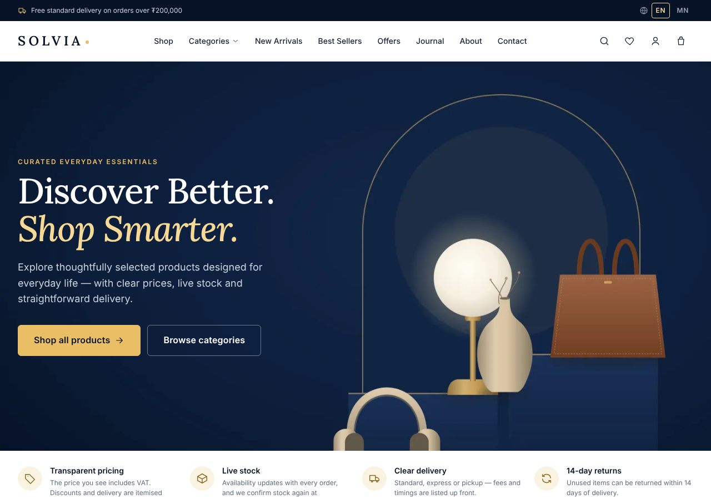
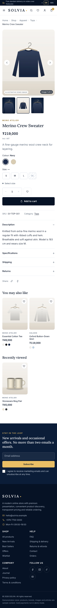
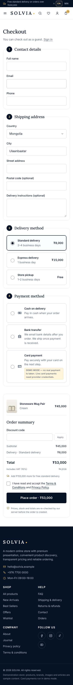
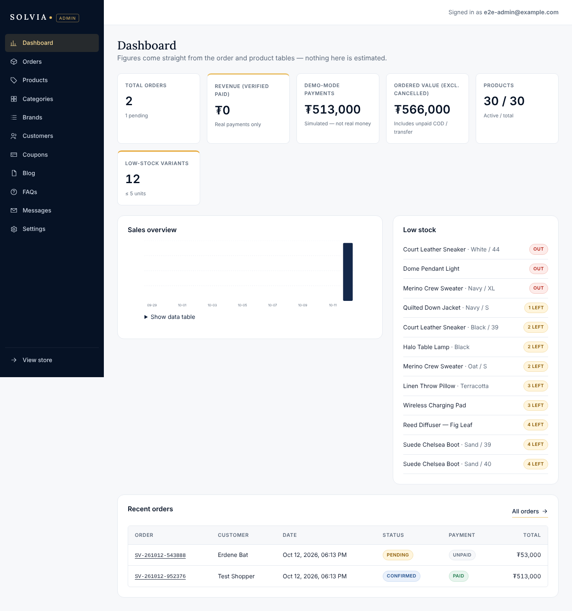
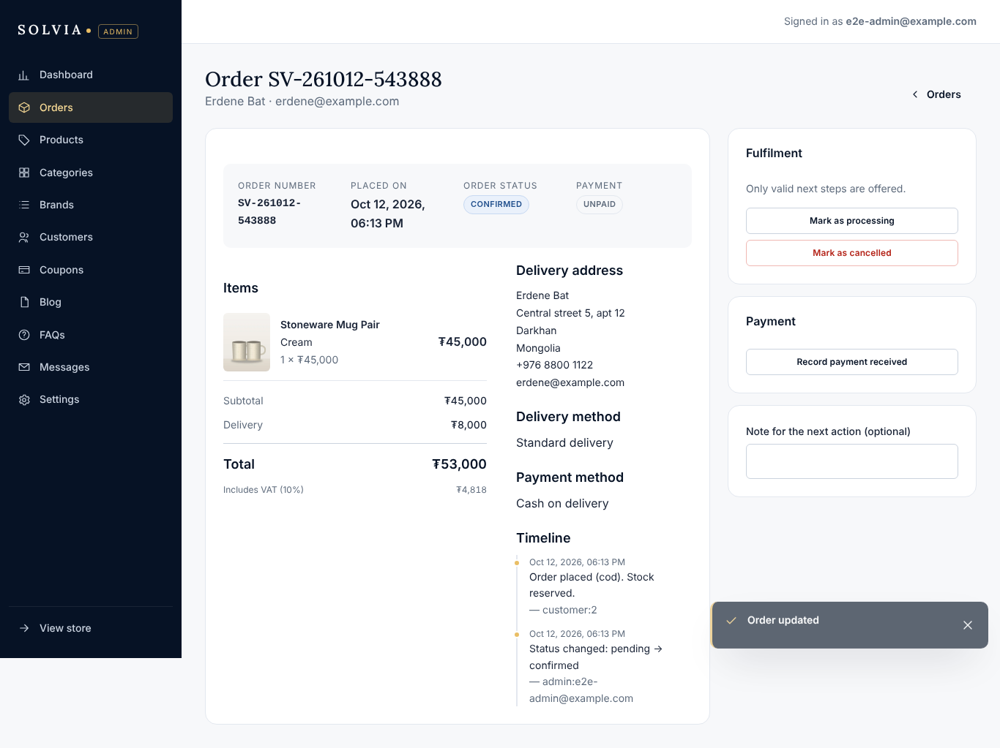
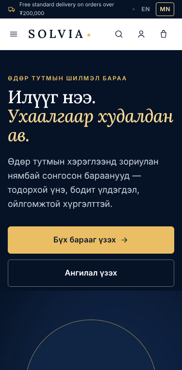
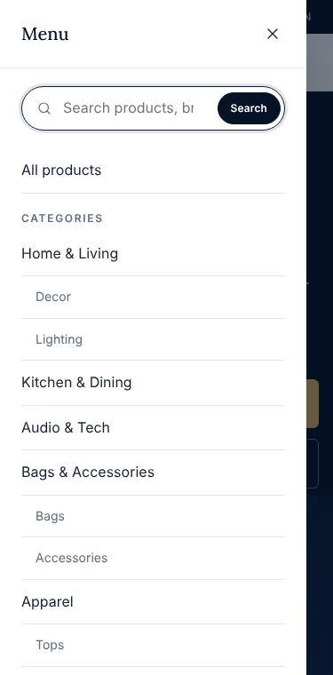

# SOLVIA — premium e-commerce store and management system

*Case study · full-stack design and engineering · demonstration project*

## The brief

Build a complete online shop — not a mockup — for a new premium brand: a storefront that feels
editorial and trustworthy, a checkout that can't be tricked, an order and inventory workflow that
stays consistent, and an admin that a small team can run the store from. Dark navy and gold were
the visual starting point; the store itself had to stay light and easy to browse. And it had to be
honest: no invented reviews, fake urgency, or pretend payments.

## What I built

- **Storefront** — 30+ routes: editorial home, catalog with real filtering (category tree, price,
  brand, colour, size, availability, sale) and sorting, product pages with variant logic, cart,
  checkout, order tracking, accounts, wishlist, journal, help and policy pages.
- **Server** — Node.js + TypeScript API on SQLite with migrations, transactions and an audit
  timeline per order. Prices, discounts, shipping, VAT and stock are always recomputed on the
  server.
- **Admin** — dashboard with real figures, product editor with a colour×size variant generator
  and image uploads, categories, brands, orders with only-valid-next-step actions, customers,
  coupons, blog, FAQs, messages, and store settings.
- **Payments** — a provider interface with a clearly labelled demo mode and a Stripe Checkout
  integration that only marks orders paid from signed, de-duplicated webhooks.
- **Bilingual UI** (English / Mongolian, draft translation clearly flagged), technical SEO with
  server-rendered meta tags and JSON-LD, analytics hooks that respect privacy.

| | |
|---|---|
|  |  |

## Design decisions

**Dark frames, light shelves.** Navy carries the brand in the announcement bar, hero, promo,
newsletter and footer; every place where people compare products — grids, product pages, cart,
checkout — is white or near-white so photography and prices stay legible. Gold is reserved for the
primary call to action, sale badges and focus states on dark surfaces; a deeper gold is used for
text on light backgrounds to keep contrast at AA.

**Typography.** Lora for display headings gives the editorial voice; Inter for everything
functional (prices use tabular numerals so columns align). Both are self-hosted under the OFL with a
Cyrillic subset for Mongolian.

**Honesty as a feature.** The homepage reviews block says reviews will appear once verified
customers leave them. Low-stock labels come from real inventory. The demo payment page says in
plain words that no money moves, and every downstream view (confirmation, account, admin) keeps
the DEMO flag. Generated product imagery is labelled as illustration.

## Engineering highlights

**No trust in the browser.** The cart in `localStorage` holds only variant ids and quantities.
Every change calls `/api/cart/quote`, which prices from the database and explains any adjustment
("only 2 left — quantity updated"). Checkout re-runs the same quote inside a write transaction.
A test tampers with the stored cart and checks the totals don't move.

**Inventory that can't oversell.** Stock is decremented with `UPDATE … SET stock = stock - ?
WHERE id = ? AND stock >= ?` inside `BEGIN IMMEDIATE`; if any line fails, the whole order rolls
back. Card orders reserve stock for 30 minutes; an expiry job cancels unpaid orders and returns
stock exactly once (guarded by a `stock_released` flag).

**Controlled order lifecycle.** A transition table defines what can follow what. The admin UI
renders only valid next steps; the server rejects anything else. Card orders can only become paid
through the provider; refunds must be recorded on the payment before the order can be marked
refunded.

**Idempotent checkout.** Each checkout attempt carries a client-generated idempotency key, so a
double-click or retry returns the first order instead of creating a second one.

**Security basics done properly.** scrypt password hashing, hashed session tokens in HttpOnly
cookies, CSRF header check, CSP and related headers, ownership checks in SQL, signed-token access
for guest orders, upload validation by file signature with re-encoding, rate limiting, and no
default admin — the first administrator is created with a CLI script.

**Performance.** Route-level code splitting (initial JS 61 kB gzip; the admin is never downloaded
by shoppers), responsive WebP images with `srcset`, lazy loading, and explicit image dimensions.
Measuring revealed a large layout shift (CLS 0.7–1.0) while route chunks loaded; reserving the
viewport for the main area brought it to 0.02–0.07.

| | |
|---|---|
|  |  |

## Testing

- **55 API and unit tests** against a real server and temporary database: pricing, stock,
  idempotency, ownership, admin authorization, payment state, reservation expiry, uploads, SEO.
- **30 browser end-to-end checks** in Chromium: complete shopper, customer and admin journeys,
  language switching, mobile navigation, horizontal-overflow checks on 12 pages at six widths, and
  basic accessibility checks.
- Testing surfaced and fixed real issues — including a way to pay for an expired order and a
  mobile cart overflow. Full report: [docs/TESTING.md](docs/TESTING.md).

## Constraints and trade-offs

- The package registry became unreachable mid-project, so I used **esbuild** directly instead of
  Vite, a small custom router instead of react-router, and local React type declarations. The
  architecture keeps a later switch simple.
- **SQLite** keeps operations trivial for a single-server shop; money is stored as integers and the
  SQL is portable for a move to PostgreSQL.
- Live payments, email delivery, analytics and Search Console are **integration-ready but not
  connected** — they need the store owner's accounts. The README lists exactly what remains before
  launch.

| | |
|---|---|
|  |  |

*All products, brands, articles and images are sample content created for this demonstration.*
